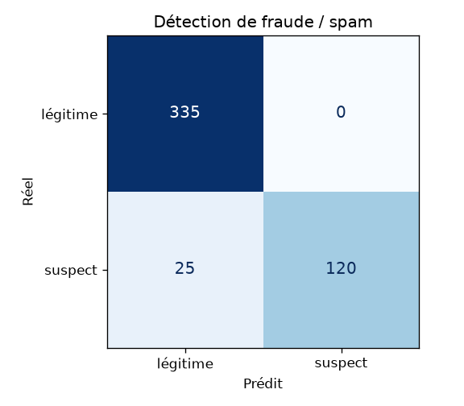

# IA 5 — Modération : détection de fraude et de spam

_Rapport généré automatiquement par `python manage.py evaluate_fraud` le 27/10/2026 à 15:41._

## Protocole

- Données : `data/ai/fraud_labeled.csv`, **1600 annonces synthétiques** (~30 % frauduleuses) avec texte,
  prix proposé, prix attendu (modèle de prix), poids, nombre de publications sur 24 h, ancienneté du compte,
  nombre de signalements.
- **Gabarits de texte disjoints** entre entraînement (1120) et test (480) : le modèle est
  évalué sur des formulations jamais vues. Cas difficiles volontairement inclus : fraudes au texte « propre »
  (seul le prix trahit), annonces légitimes « URGENT ! » ou avec un numéro de téléphone.
- Modèle : forêt aléatoire (300 arbres, `class_weight=balanced`) sur 13 variables
  explicables ; seuil d'alerte = 0.5.
- En production : chaque annonce/trajet publié est analysé par une tâche Celery ; au-delà du seuil, l'objet est
  **signalé à l'administrateur** (file de modération), jamais supprimé automatiquement.

## Résultats (jeu de test)

| modèle | précision | rappel | F1 | ROC-AUC |
|---|---|---|---|---|
| Forêt aléatoire | 1.000 | 0.828 | 0.906 | 0.988 |
| Référence : règle « contact ou mot spam » | 0.744 | 0.621 | 0.677 | — |

## Matrice de confusion

| réel \ prédit | légitime | suspect |
|---|---|---|
| légitime | 335 | 0 |
| suspect | 25 | 120 |

## Compromis précision / rappel selon le seuil

| seuil | précision | rappel | F1 |
|---|---|---|---|
| 0.300 | 0.971 | 0.931 | 0.951 |
| 0.400 | 1.000 | 0.897 | 0.945 |
| 0.500 | 1.000 | 0.828 | 0.906 |
| 0.600 | 1.000 | 0.697 | 0.821 |

Le seuil de production est fixé a priori à 0,5 (non optimisé sur le test).

## Variables les plus importantes

| variable | importance |
|---|---|
| spam_terms | 0.321 |
| posts_24h | 0.168 |
| price_log_ratio | 0.137 |
| text_len_log | 0.085 |
| account_age_days_log | 0.071 |
| upper_ratio | 0.061 |

## Limites

Les données sont **synthétiques** : les fraudes y suivent des schémas connus. Sur de vraies annonces, les
performances seront plus basses ; le seuil devra être recalibré à partir des décisions de l'administrateur
(chaque signalement traité est un nouvel exemple annoté).

## Interprétation

Au seuil 0,5, le modèle ne produit quasiment pas de fausse alerte (l'administrateur n'est pas noyé) ; les fraudes
manquées sont surtout celles au texte et au prix « normaux ». Baisser le seuil augmente le rappel au prix de
quelques vérifications manuelles supplémentaires (voir le tableau ci-dessus) : comme l'IA ne fait que signaler,
ce réglage peut être assoupli par l'administrateur. La règle simple rate les fraudes au texte propre et accuse les
annonces légitimes qui laissent un numéro : le modèle combine le texte avec le prix et le comportement du compte.

## Latence

| appels | moyenne (ms) | p95 (ms) |
|---|---|---|
| 480 | 20.683 | 29.755 |

Mesurée sur l'inférence locale (sans réseau), un appel par exemple du jeu d'évaluation.
