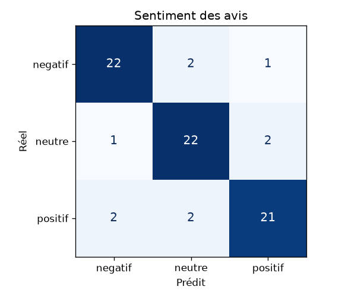

# IA 4 — Sentiment des avis et réputation

_Rapport généré automatiquement par `python manage.py evaluate_sentiment` le 27/10/2026 à 15:41._

## Protocole

- Entraînement : `data/ai/reviews_sentiment_train.csv`, **1900 avis** générés à partir de gabarits
  français variés (3 classes équilibrées + négations « pas du tout … »).
- Test : `data/ai/reviews_sentiment_test.csv`, **75 avis rédigés à la main**, formulations jamais
  vues à l'entraînement (pas de fuite de données).
- Modèle : TF-IDF mots (1–2-grammes) + caractères (3–5-grammes, robuste aux fautes et accents) →
  régression logistique (`class_weight=balanced`).
- Usage : chaque nouvel avis est classé par une tâche Celery ; le sentiment alimente le **score de
  réputation** du transporteur (60 % note moyenne + 40 % sentiment, lissage bayésien vers 50 avec k = 3).

## Résultats (jeu de test)

| classe | précision | rappel | F1 | support |
|---|---|---|---|---|
| negatif | 0.880 | 0.880 | 0.880 | 25 |
| neutre | 0.846 | 0.880 | 0.863 | 25 |
| positif | 0.875 | 0.840 | 0.857 | 25 |
| **macro** | 0.867 | 0.867 | 0.867 | 75 |

Exactitude globale : **86.7%**.

## Matrice de confusion

| réel \ prédit | negatif | neutre | positif |
|---|---|---|---|
| negatif | 22 | 2 | 1 |
| neutre | 1 | 22 | 2 |
| positif | 2 | 2 | 21 |

## Limite méthodologique

Le vocabulaire générique des gabarits d'entraînement (mots isolés positifs / négatifs / neutres) a été élargi
**une fois après une première évaluation** (v1 : F1 macro = 0,774). Le jeu de test a donc servi en partie au
développement : le score ci-dessus est probablement un peu optimiste. Pour une mesure strictement non biaisée,
il faudrait annoter un second jeu d'avis réels collectés sur la plateforme (prévu dès que des avis réels
existent : `Review.sentiment` est conservé pour cela).

## Erreurs

| avis | réel | prédit |
|---|---|---|
| Très satisfait, la marchandise est arrivée à Tunis le jour prévu, sans aucune casse. | positif | negatif |
| Très pro, il nous a envoyé des photos du chargement. | positif | negatif |
| Un vrai plaisir de travailler avec lui. | positif | neutre |
| Aucun souci, carrelage livré sans un seul carreau cassé. | positif | neutre |
| Impossible de joindre le chauffeur pendant la livraison. | negatif | neutre |
| Prix final bien plus élevé que prévu, je suis mécontent. | negatif | neutre |
| Facture fausse et service lent. | negatif | positif |
| Délai respecté, emballage d'origine conservé. | neutre | negatif |
| Transport assuré, rien d'autre à dire. | neutre | positif |
| La marchandise est arrivée, le suivi pourrait être meilleur. | neutre | positif |

## Latence

| appels | moyenne (ms) | p95 (ms) |
|---|---|---|
| 75 | 1.525 | 2.088 |

Mesurée sur l'inférence locale (sans réseau), un appel par exemple du jeu d'évaluation.
